<a href="https://xenomorph27.github.io"></a>

```console
~ $ cat about.txt
I build models that see and the systems that ship them: sign-language
translation, wildlife detection on edge hardware, and tools that take the
busywork off researchers and educators.
```

<p>
  <a href="https://xenomorph27.github.io"></a>
  
  
  
</p>

## `> repositories`

**computer vision**

| repo | what it does | key result | status |
| --- | --- | --- | --- |
| [HyperTranslator](https://github.com/Xenomorph27/HyperTranslator) | Real-time Indian Sign Language to English: MediaPipe Holistic → Transformer encoder → Gemini | ISL → English, live |  |
| [wildlife-classifier-prov2](https://github.com/Xenomorph27/wildlife-classifier-prov2) | Two-stage wildlife pipeline: YOLOv8x detects, EfficientNet-B4 classifies | ≈91.5% acc · 52 species |  |
| [edge-wildlife-classifier](https://github.com/Xenomorph27/edge-wildlife-classifier) | Deer / elk / moose classifier with confidence-aware predictions on a Raspberry Pi | 3 classes, on-device |  |

**research & edtech**

| repo | what it does | key result | status |
| --- | --- | --- | --- |
| [Findress](https://github.com/Xenomorph27/Findress) | Every AI/ML conference, workshop and journal in one view, with a CFP-grounded assistant | [findress.vercel.app](https://findress.vercel.app) |  |
| [obe-automate](https://github.com/Xenomorph27/obe-automate) | Syllabus → CO-PO mapping, lesson plans, attainment and NBA/NAAC reports | [obe-automate.vercel.app](https://obe-automate.vercel.app) |  |

**business software**

| repo | what it does | key result | status |
| --- | --- | --- | --- |
| [Client Desk](https://github.com/Xenomorph27/Client-Relationship-Management-System) | CRM for a woodcraft business: orders, logistics, inventory and outreach | React 19 + FastAPI + PostgreSQL |  |

## `> stack`

**languages**<br>


**frontend**<br>


**backend**<br>


**ai & ml**<br>


**databases & orm**<br>


**devops & hardware**<br>


---

<sub>`exit 0` · full interactive version at <a href="https://xenomorph27.github.io">xenomorph27.github.io</a></sub>
